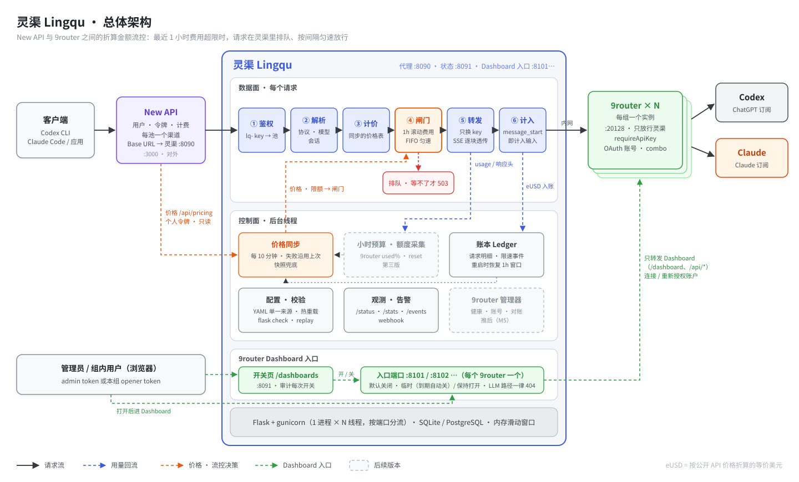

# 灵渠（Lingqu）设计文档

> 实现状态：M5 已加入控制台、9router API 管理、完整模型路由、Redis 多实例和用户限流。下文单进程运行约束描述 M1～M4 默认内存后端；Redis 模式、升级与最新配置以 [M5.md](M5.md) 为准。
> 版本：v0.6 · 2026-10-21
> - v0.2：上游从仅 Codex 扩展为 Codex / Claude
> - v0.3：流控改为以 1 小时为控制周期（动态小时预算）；架构图改为 SVG
> - v0.4：上游池可对应多个 9router 实例；超限默认挂起而不是 429；实现改为 Python（基于 flasky 骨架）；控制台和 9router 管理器推后
> - v0.5：吸收已运行的旁路限速方案的经验（分级降速档位、缓存寿命约束、回放方法、安全边界、观测与告警、配置校验）；价格表改为从 New API 或 9router 同步；Flask 实现细化（流式透传、运行模型、部署方式）；9router Dashboard 入口按需开放；默认放行方式从分级停放改为 FIFO 匀速出队（回放数据见 §4.5）
> - v0.6（M3）：会话感知的 FIFO（按每个请求自己的缓存期限出队，§4.5，回放结果见 §4.5.1）；并发上限先 shadow、空出的名额按等待先后分配（§4.3 ④）；错误分类补全（流内错误、连不上 9router）和按连续次数告警（§4.7、§6.4）
>
> 本文只讲灵渠本身。具体部署怎么接入、怎么从原有限速方案迁移，由各部署方自己的文档说明。
>
> 灵渠是秦代开凿的运河，用"陡门"分级蓄水、控制水流，让船只平稳翻越落差。本项目做的事情差不多：
> 架在 New API 和 9router 之间，按**折算后的消耗金额**给流量"分级蓄水"，避免 Codex / Claude 订阅额度被过快用完。

---

## 1. 背景与目标

### 1.1 现状

```
用户/客户端 ──► New API ──► 9router ──┬─► Codex  （ChatGPT 订阅，OAuth 登录）
               (多用户、令牌、计费)  (本地路由、OAuth、fallback) └─► Claude （Claude 订阅，OAuth 登录）
```

- **New API** 负责多用户、令牌、分组、倍率计费和渠道管理。它算的是"用户该扣多少额度"，**不知道上游订阅还剩多少**。
- **9router** 通过 OAuth 登录了 Codex 和 Claude，对外提供 OpenAI / Anthropic 兼容接口（默认 `:20128/v1/*`），有 combo/fallback 和用量统计，但**没有按金额或时间窗限速的能力**。
- 常见的部署是**每个用户组一个 9router 实例**：实例里只连本组的账户，New API 每组一个渠道指向它，用物理隔离保证一个组的请求不会落到别组的账户上。
- **订阅各有自己的滚动窗口限额**：

| 上游 | 限额形态（公开信息，以实际为准） | 特点 |
|------|----------------------------------|------|
| Codex（ChatGPT Plus/Pro） | 短窗口（通常 5h）+ 周窗口 | 推理强度越高越费额度 |
| Claude（Pro/Max） | 5h 会话窗口 + 周窗口，部分套餐对 Opus 单独设周限额 | Opus 远比 Sonnet 费额度；Prompt 缓存对额度影响很大 |

用户一旦集中使用，短窗口很快打满，周额度也可能提前用完，严重时还会触发风控。

### 1.2 旁路限速的经验

在没有灵渠之前，一种可行的做法是**旁路限速**：一个独立服务每 20 秒读一次 New API 的消费日志，按"组 × 上游"算滚动 60 分钟的折算费用，超过限额就用管理员身份停用、启用对应的 New API 渠道，让客户端收到 503 后自己重试。这套做法实际跑了一段时间，留下了几条直接影响灵渠设计的经验：

**做对了的**（灵渠照搬）：

- **按金额，不按次数。** 一个 Claude Code 请求的折算费用从 $0.1 到近 $4 都有，按请求次数限流完全不准。New API 自带的限流只能按次数、按"用户 + 分组"计数，不适用。
- **分级降速，不一直停。** 超限后"停一会儿、放一会儿"交替进行，超得越多停得越久、放得越短；回落到限额以下立刻恢复。用一周真实日志回放比较：一直停到回落，60 分钟峰值确实最低，但单次最长停 29 分钟、一周报错 389 次，还因为缓存一次次过期多花了 $244；五档降速没有报错，缓存过期只多花 $3。
- **单次停不超过 2 分钟。** 原因有两个：一是 Claude Code 对 503 的重试一共只能等约 3 分钟（0.5 秒 × 2^(n−1)，单次最长 32 秒，加 0～25% 抖动，默认 10 次）；二是第 1.3 节说的缓存寿命。
- **要收紧，缩短"放"，而不是拉长"停"。** 回放显示，把单次停拉长到 5～8 分钟，60 分钟峰值反而从 $34 升到 $52～78，因为缓存过期带来的重建费用远超省下的钱。降低限额也一样：限额从 $20 降到 $10，峰值不降反升。
- **限额全组共享，按上游分开。** Claude 和 Codex 各算各的，一边被限不影响另一边。
- **配置单一来源、可重复应用、有验收检查。** 规则只写在一个文件里，由脚本同步到各组件，再由检查脚本逐项核对。

**做得不好的**（灵渠要解决）：

- **依赖 New API 的管理员会话。** 开关渠道要登录 New API。实际发生过：access token 只有 15 分钟，旁路服务每次过期都重新登录，30 天有效的会话越攒越多，撞上每用户会话上限后登录一直失败，限速悄悄停了 10 小时。
- **发现得晚。** 费用要等请求结束、New API 写完日志、再过一个读取周期才算进去。一个 $4 的缓存重建请求，要几十秒后才"看得见"。
- **整个渠道一起开关太粗。** "停"的时候命中缓存的 $0.16 小请求和 $4 的大请求一起被挡；"放"的时候又会溜过去一个大请求，60 分钟峰值超出限额 70%。
- **体验靠客户端重试。** New API 不把上游的 `Retry-After` 转给客户端，客户端只能按自己的退避规则等，被挡请求的中位等待是 73 秒，比实际需要的长。
- **状态寄存在别人的字段里。** "正在被限速"的标记写在 New API 渠道的扩展字段里，手工停用、启用渠道都要绕开它。

### 1.3 钱花在哪里：缓存寿命是硬约束

- Claude Code 经网关时用的是 **5 分钟** prompt cache。缓存在每次读取时续期；两个请求的开始时间相隔超过 5 分钟，缓存就失效。
- 长会话的上下文常在 60 万～80 万 token。在 Opus 上，重建一次缓存约 $3～4，而一次命中缓存的请求中位只要 $0.17。
- 一个真实的上午：81 个请求花了 $35.6，其中 7 个缓存重建（或未命中缓存）的请求合计约 $23，占三分之二；输出 token 一共只有 6 万。
- 所以：**控制费用的关键是上下文大小和缓存命中率，不是输出多少**；任何一次人为的等待都不能把会命中缓存的请求拖过 5 分钟。

### 1.4 目标

| # | 目标 | 说明 |
|---|------|------|
| G1 | **按折算金额流控** | 把每次请求的 token 用量按价格表折算成"等价美元"（eUSD），在多个时间窗内限额、匀速 |
| G2 | **匀速消耗、及时调整** | 以 **1 小时**为控制周期；首版是固定的每小时限额，之后把周期额度按权重拆成动态的小时预算（§4.3） |
| G3 | **按池独立核算** | 池 = 一个订阅账户的一类上游（通常是"组 × 上游"）。各池分开计量、分开限额，互不影响，**不跨池回退** |
| G4 | **在数据路径上就地计量** | 请求一开始就计入输入和缓存的费用（Anthropic 的 `message_start`），不等请求结束，也不读别人的日志 |
| G5 | **超限时行为友好** | 默认在灵渠里**挂起**请求，等到放行再转发，客户端只看到首字节变慢；挂起时间受缓存寿命和下游超时约束（§4.5）。实在等不了才返回 503 |
| G6 | **对 New API 透明，也不依赖它的管理接口** | New API 只把灵渠当作普通的 OpenAI / Claude 渠道；流控不登录 New API、不开关渠道。只读的价格同步用个人访问令牌（§3.2） |
| G7 | **价格不自己维护** | 价格表从 New API 或 9router 同步（§3.2），和计费、统计口径一致 |
| G8 | **可观测、可回放、可校验** | 状态 JSON、限速事件、按池统计、告警；用历史数据回放规则；一条命令核对配置和链路（§6～§8） |
| G9 | **9router Dashboard 可控开放** | 用户要自己登录 9router 连接、重新授权账户。Dashboard 默认关闭，由灵渠按需临时打开或保持打开，开放时也不暴露 LLM API（§2.4） |

### 1.5 非目标

- 不重复造 New API 的用户体系和计费（灵渠不管"用户充了多少钱"）。
- 不替代 9router 的协议转换和 OAuth 登录（灵渠不直连 Codex / Claude）。
- 不做跨池的故障转移或降级：一个池超限或故障，请求就等或者失败，不借用别的账户。
- 首版不做多节点集群（单实例 + 本地存储，留扩展口）。
- 首版不做控制台和 9router 管理器（§13）。配置由部署方的脚本生成，展示由部署方已有的页面读灵渠的状态 JSON 完成。唯一的 HTML 页面是 Dashboard 入口的开关页（§2.4）。

---

## 2. 总体架构



灵渠分两层：

- **数据面**（每个请求都经过）：① 鉴权（key → 池）→ ② 解析（协议、模型、会话）→ ③ 计价（同步来的价格表）→ ④ 闸门（1h 滚动费用、并发）→ ⑤ 反向代理（SSE 逐块透传）→ ⑥ 计入（Anthropic 在 `message_start` 就先计入输入和缓存）。闸门不放行时**挂起**，等不了才返回 503。
- **控制面**（后台线程）：价格同步、账本写入、计数快照、小时预算计算（第三版）、9router 额度采集（第三版）、告警。

### 2.1 上游池（Pool）

**池**是流控和计量的基本单位，对应"一个订阅账户的一类上游"。每个池有：

- 一个上游（`upstreams` 里的一个 9router 实例：地址、key、Dashboard 入口设置）。一个 9router 实例可以服务多个池，比如同一个组的 Claude 池和 Codex 池；
- 一个 `kind`（`claude` / `codex`），决定用哪套 usage 解析和价格；
- 一组规则（§4.3）。

**池的两种确定方式**：

| 方式 | 适用 | 说明 |
|------|------|------|
| **按 key**（推荐） | 有多个 9router 实例，比如每个用户组一个 | 每把 `lq-` key 只绑一个池。New API 的一个渠道用一把 key，池由渠道决定，不用猜模型。找不到 key 就 401，没有"默认池"（fail-closed） |
| 按模型名 | 只有一个 9router，Codex 和 Claude 都连在里面 | 一把 key 对应一个 9router，再按模型名分到池：显式表优先，其次通配符，都不中就归到 `unknown` 池并告警 |

池的名字是自由的，比如 `team-a/claude`、`team-a/codex`。

- **跨池的 combo**（按模型名分池时，9router 的 combo "先 Claude 再 Codex"）：按 9router 实际命中的模型记到对应的池，实际模型从响应的 `model` 字段获取。按 key 分池时不存在这个问题：一个 9router 实例只服务一个组，combo 只会在本组的上游之间切换，同属一个池。

### 2.2 部署拓扑

放在同一个内网中（docker compose 或 k8s 命名空间都行）。**9router 的端口在网络层只放行灵渠**，用户和管理员要进 9router Dashboard 时也经过灵渠（§2.4）：

| 服务 | 端口 | 谁能访问 | 备注 |
|------|------|----------|------|
| new-api | 3000 | 最终用户 | 每个池一个渠道，Base URL 指向 `http://lingqu:8090`，渠道 key 是该池的 `lq-` key |
| lingqu | 8090（代理） | 只有 New API | LLM 流量 |
| lingqu | 8091（状态与管理） | 内网 | 状态 JSON、管理接口、Dashboard 入口的开关页面 |
| lingqu | 每个 9router 一个 Dashboard 入口端口（如 8101、8102…） | 内网，**默认关闭** | 打开后才转发到对应 9router 的 Dashboard，见 §2.4 |
| 9router（一个或多个） | 20128 | 只有灵渠（部署方的只读脚本可以另外放行） | 开启 `requireApiKey`，key 只给灵渠 |

### 2.3 技术选型

| 维度 | 选择 | 理由 |
|------|------|------|
| 语言 / 框架 | **Python 3.12 + Flask 3**，基于 flasky 骨架（应用工厂 `create_app`、蓝图、`config.py` 分环境配置、`flask` CLI 命令、`unittest` 测试、pip-tools 锁文件） | New API / 9router 周边的运维脚本多是 Python，维护的人只需要会一门语言；flasky 骨架已经有配置、迁移、测试、Docker |
| WSGI 服务器 | **gunicorn，1 个 worker × N 线程（gthread）** | 计数器、出队时刻、排队队列都在进程内存里，所以只能有一个进程；每个流式或挂起中的请求占一个线程，详见 §11.2 |
| 上游 HTTP | `httpx`（同步 `Client`，`stream=True`，`iter_raw()`），连接池 | 逐块读取、原样转发；连接、读取超时可以分开设 |
| 存储 | Flask-SQLAlchemy + Flask-Migrate（Alembic），SQLite（WAL）默认，可选 PostgreSQL | 沿用 flasky 的迁移流程；账本批量写入 |
| 计数器 | 进程内滑动窗口（60 × 1 分钟桶）+ 定期快照；重启时从账本重放 | 单进程就够。接口抽象成 `CounterStore`，以后多实例再换 Redis |
| 配置 | 一个 YAML 文件（PyYAML），由部署方生成；密钥走环境变量 | 规则单一来源，见 §8 |
| Tokenizer | 首版不做。第二版只需要判断"会不会命中缓存"（§4.4） | 大请求的费用几乎都在输入侧，`message_start` 一到就能计入 |
| 前端 | 首版不做，只提供 JSON；以后需要控制台时用 flasky 已有的 Jinja2 + Bootstrap 5 | 少一套构建工具链 |

> **为什么不用 ASGI（FastAPI / Starlette）**：异步框架处理大量长连接更省资源，但目标场景（几个到几十个用户共享几个订阅）的并发只有个位数到几十，线程模型足够，而且 flasky 骨架、Flask-SQLAlchemy、测试方式都能直接复用。流控核心（`gate/`）不依赖 Flask，以后并发上到几百时，可以只把代理层换成 ASGI。


### 2.4 9router Dashboard 入口

**问题**：用户要自己登录 9router，连接或重新授权 Codex / Claude 账户、建 combo、查看账户额度，所以 Dashboard 必须能从内网访问。但是：

- 9router 的 Dashboard 和 LLM API 在**同一个端口**（20128）上，靠路径区分（`/dashboard`、`/api/*` 是 Dashboard；`/v1`、`/v1beta`、`/api/v1`、`/codex`、`/responses` 是 LLM API）。在网络层开放这个端口，就同时开放了 LLM API。LLM API 虽然要 key，但这样就多了一条绕过灵渠的路径，限额和计量都会失效。
- 9router 的 Dashboard 只有一个密码，没有用户和角色。长期开着，密码就是唯一的防线。
- 9router 不支持 `basePath`，Dashboard 写死在根路径下，没法挂到 `/<router>/` 这样的子路径下，只能一个实例一个端口（或一个域名）。

**做法**：灵渠为每个 9router 实例开一个 **Dashboard 入口**（反向代理），由灵渠决定开不开：

| 状态 | 行为 | 怎么进入 |
|------|------|----------|
| `closed`（默认） | 入口端口只返回一个说明页："Dashboard 入口已关闭"，并给出打开的地址；不转发任何请求 | 默认；到期自动回到这个状态；随时可以手动关闭 |
| `temporary` | 转发 Dashboard 的请求，到期自动关闭。默认 30 分钟，最长 `max_ttl`（默认 4 小时）；还在用的时候可以延长 | 在开关页面上点"打开 30 分钟"，或者 `POST /admin/dashboards/<upstream>/open`、`flask dashboard open <upstream> --for 30m` |
| `persistent` | 一直转发，直到手动关闭 | 在开关页面上选"保持打开"。可以按实例禁止这个选项（`allow_persistent: false`） |

- **无论哪种状态，入口都不转发 LLM 路径**（`/v1*`、`/api/v1*`、`/codex`、`/responses`），一律返回 404。开放 Dashboard 不会多出一条绕过灵渠的 LLM 通道。
- **谁能打开**：管理员（admin token），以及配置在该实例上的 `openers`。每个 opener 是一把 token，可以发给这个组的用户，让他们自己打开本组的 9router，不需要找管理员，也碰不到别组的实例。
- **开关页面**：8091 上的 `/dashboards`，列出每个实例的状态、到期时间、最近一次是谁打开的，以及三个按钮："打开 30 分钟""保持打开""关闭"。用 token 登录，登录后只显示这个 token 能管的实例。这是首版唯一的 HTML 页面（Jinja2 模板，没有前端构建）。
- **审计**：每次打开、延长、关闭、到期，都记一条 `exposure_events`（谁、什么时候、哪种状态、到期时间）；`/status` 显示每个实例的当前状态；进入 `persistent` 时告警一次。
- **重启**：状态存在数据库里。`persistent` 重启后保持；`temporary` 按剩下的时间继续。
- **转发细节**：
  - 原样转发请求头、cookie 和请求体，支持流式响应。9router 登录后的 `auth_token` cookie 只在这个入口端口上有效。
  - 灵渠和 9router 不能在同一个 Pod 或网络命名空间里。9router 会把来自 loopback 的请求当成本机请求，免登录、免 key；灵渠从另一个 IP 连过去，它就始终按远程请求处理。
  - 不转发 `X-Forwarded-*` 之类的头，也不伪造 9router 的可信对端头。
- **OAuth 授权不需要额外端口**（按 9router 0.5.x 的实现）：
  - 9router 的授权回调地址都写死在 `localhost`：Codex 是 `localhost:1455/auth/callback`，Claude 是 `localhost:<Dashboard 端口>/callback`。浏览器不在 9router 那台机器上时，登录完成后跳转的这个地址会打不开。
  - 9router 对这种情况有手动模式：Dashboard 不是用 `localhost` 打开时（经过灵渠的入口就是这样），授权窗口会显示一个输入框。用户把跳转后地址栏里的完整地址（打不开也没关系）粘回去，9router 自己从中取出 code 换 token。
  - 所以 1455 端口不用开放，也不用 SSH 隧道。这个步骤要写进用户手册，升级 9router 后要复测。

**多个实例怎么分配地址**：

- 默认按端口：每个实例配置一个 `dashboard.port`，比如 8101、8102。灵渠的同一个进程监听所有入口端口（§11.2）。
- 有内网 DNS 时，也可以按域名：`dashboard.host: team-a.dash.example`，所有实例共用一个端口，按 `Host` 头分流。

---

## 3. 折算金额与价格表

订阅制没有真实账单，但订阅额度本质上和"算力消耗"相关。灵渠用**各家 API 公开价格**把 token 折算成"等价美元（eUSD）"，作为统一度量。

### 3.1 折算公式

两家的 usage 字段不同，先统一成四类 token 再计价：

| 统一字段 | OpenAI / Codex | Anthropic / Claude |
|----------|----------------|--------------------|
| `input_uncached` | `prompt_tokens - cached_tokens`（responses：`input_tokens - cached_tokens`） | `input_tokens`（本身就不含缓存部分） |
| `input_cache_read` | `prompt_tokens_details.cached_tokens` | `cache_read_input_tokens` |
| `input_cache_write` | 0（OpenAI 自动缓存，写入不另计费） | `cache_creation_input_tokens`（有 `cache_creation.ephemeral_5m/1h_input_tokens` 时分别计价） |
| `output` | `completion_tokens`（含 reasoning） | `output_tokens`（含 thinking） |

```
cost = ( input_uncached    × P_in
       + input_cache_read  × P_cache_read
       + input_cache_write × P_cache_write     # Claude: 5m ≈ 1.25 × P_in, 1h ≈ 2 × P_in
       + output            × P_out
       ) / 1_000_000
       × model_multiplier                      # optional: "this model costs more of the subscription"
```

- 价格的单位是 USD / 1M tokens，来源见 §3.2。
- `model_multiplier` 默认 1，只在想表达"同样的 eUSD，这个模型更费订阅额度"时才设。

### 3.2 价格表来源

灵渠**不自己维护价格**，而是定期从部署里已有的组件同步。这样灵渠的数字和 New API 的日志、9router 的用量页一致，改价格也只改一处。

| 来源 | 接口 | 鉴权 | 返回内容 | 适用 |
|------|------|------|----------|------|
| **New API**（推荐） | `GET /api/pricing` | 模型广场公开时匿名可读；关闭时需要 **root 的个人访问令牌**（`Authorization: Bearer nap_…`，New API 对这个接口接受任何有效令牌） | 每个模型一条：`model_ratio`（1 = $2 / 1M 输入）、`completion_ratio`、`cache_ratio`、`create_cache_ratio`；按次计费的模型给 `model_price` | 灵渠前面有 New API 时。和 New API 日志里的金额同一口径 |
| **9router** | `GET /api/pricing` | 9router 控制台登录（密码换 `auth_token` cookie） | `{provider: {model: {input, output, cached, cache_creation, reasoning}}}`，直接是 $/1M；合并了用户改过的和内置的默认价 | 没有 New API，或者想和 9router 用量页一致时 |
| **静态** | 配置文件里的 `pricing.static` | — | $/1M | 测试，或以上都拿不到时 |

**换算**（New API 来源）：

```
P_in          = model_ratio × 2
P_out         = P_in × completion_ratio
P_cache_read  = P_in × cache_ratio           # missing: 0.1 × P_in
P_cache_write = P_in × create_cache_ratio    # missing: 1.25 × P_in; 1h writes: 2 × P_in unless New API says otherwise
```

- **不乘分组倍率**。New API 的分组倍率是"对用户收多少钱"，eUSD 是"对上游订阅消耗多少"（§3.5）。分组倍率都是 1 的部署，两边数字完全一致；不是 1 的，灵渠的数字会和 New API 日志差一个倍率，这是预期的。
- 按次计费（`model_price`）的模型，每次请求按固定金额计入。

**同步与兜底**：

- 后台线程每 10 分钟同步一次（可配），成功后整体替换内存里的价格表，并写一份快照到数据库（`price_snapshots`）。
- 同步失败时**保留上一次的价格**；重启时先加载最近的快照，所以价格源暂时不可用也不影响计量。超过 24 小时没同步成功，`/status` 标黄并告警。
- 优先级：配置里的 `pricing.overrides` > 同步来的价格 > 池的 `default_price`。
- 查不到价格的模型，用池的 `default_price` 计入，同时记进 `/status` 的 `unpriced_models`，并告警一次。不拒绝请求：拒绝是 New API 的职责（它对未定价的模型本来就会拒绝）。
- 价格变了**不回溯**：账本里同时存 token 数和当时算出的 eUSD；回放（§7）可以用新价格重算。

**访问凭据的教训**：

- 读 New API 一律用**个人访问令牌**，不用账号密码登录。登录会话有数量上限，长驻进程每次过期就重新登录，迟早会把管理员锁在外面。
- 9router 只有控制台密码，必须登录：会话过期时才重新登录；**登录失败后至少等 30 分钟再试**，因为反复失败会被 9router 锁定。

### 3.3 模型名归一化

灵渠看到的模型名不一定是价格表里的名字：

- New API 的渠道常用 `model_mapping` 给模型名加上 9router 的前缀再转发，比如 `claude-opus-5-5` → `cc/claude-opus-5-5`，`gpt-6.1-sol` → `cx/gpt-6.1-sol`；
- Claude Code 可能发带 `[1m]` 后缀的名字；
- 9router 的 combo 用不带前缀的名字。

查价顺序：原名 → 去掉配置的前缀（`strip_prefixes`，默认 `cc/`、`cx/`、`os/cx/`；或者干脆去掉最后一个 `/` 之前的部分）→ 去掉 `[1m]` 后缀 → 池的 `default_price`。New API 来源按对外的模型名查；9router 来源按 provider（由前缀推出）+ 模型名查。响应里的 `model` 字段如果和请求不同，以响应为准。

### 3.4 不同池的 eUSD 不能直接比较

Codex 的 1 eUSD 和 Claude 的 1 eUSD 对各自订阅额度的消耗比例不同，所以**限额必须按池分别设定**，不要设一个跨池的总额度。跨池只做展示汇总（例如"今天一共折合 $12"）。

### 3.5 为什么不直接用 New API 的额度

New API 的 quota 是"对用户收费"的口径，带分组倍率、充值折扣，而且只在请求结束、写完日志之后才有。灵渠用 New API 的**价格**，但不用它的**额度**：eUSD 是"对上游订阅消耗"的口径，在数据路径上实时计算。

---

## 4. 流控模型（陡门）

### 4.1 作用域（谁被限）

请求必须**所有命中的规则都放行**才会被转发：

| 作用域 | 标识来源 | 典型用途 |
|--------|----------|----------|
| `pool` | key 或模型名得到的池 | **主要作用域**，对应一个订阅账户的一类上游 |
| `model` | 归一化后的模型名 | 例如单独限制 Claude Opus（对应 Opus 的单独周限额） |
| `session` | Claude Code 的会话 id（§4.4） | 单个会话的并发上限 |
| `user`（可选） | 部署方传入的用户标识（§4.8） | 单用户防刷 |
| `global` | — | 只用于并发 / RPM 这类和金额无关的总量保护 |

作用域可以组合，例如 `pool=team-a/claude & model=claude-opus-*`。

### 4.2 设计思路：以 1 小时为控制周期

上游的 5h / 7d 窗口太长，等发现超了已经来不及。灵渠用**最近 1 小时的滚动费用**来判断：

- **反应快**：一阵猛用之后，最多 1 小时内就被约束住，不会把整个 5h 窗口吃光。
- **没有整点突发**：滚动窗口按 1 分钟一个桶，共 60 个桶，没有"整点清零"。
- **上游的 5h / 7d 只作为约束条件**（第三版），灵渠实际控制的是 1h。

限额本身有两种：

| 规则 | 1 小时限额 | 版本 |
|------|------------|------|
| `hourly_cap` | 固定值，比如 $20 | 首版 |
| `hourly_budget` | 动态的 `H(t)`，由周期剩余额度、小时权重、上游真实余量算出（§4.3） | 第三版 |

### 4.3 闸门

**① 每小时限额（`hourly_cap`）** —— 首版的主闸门

```
ratio = used_1h / limit
ratio < 1  → open: pass
ratio ≥ 1  → throttled: released per `release` (§4.5)
```

`used_1h` 包含已经计入的部分（进行中的请求在 `message_start` 时已计入输入和缓存）。

**② 小时预算（`hourly_budget`）** —— 第三版

每个池（也可以是 `model` 作用域）各有一个预算：

```
R      = L − used_cycle                       # remaining eUSD this cycle
W_rem  = Σ weights of the hours left in the cycle
base   = R × w(current hour) / W_rem
H(t)   = clamp( base × (1 + flex),  H_min,  H_max )
H(t)   = min( H(t),  S_rem )                   # never above what the upstream 5h window has left

ratio  = used_1h / H(t)
```

| 参数 | 含义 | 建议值 |
|------|------|--------|
| `L` | 周期总额度，周期对齐上游 7d 重置时间 | 按订阅档位设定，再用上游 used% 校准 |
| `w(h)` | 一周 168 个小时各自的权重 | 默认工作时间 1.0、夜间 0.2、周末 0.5；也可以按最近 4 周的实际使用曲线自动生成 |
| `flex` | 弹性系数，允许本小时比均摊值多用一些 | 0.5（即最多 1.5 倍） |
| `H_min` | 预算下限，保证再紧也有基本可用量 | 例如 $2 |
| `H_max` | 预算上限，避免周期末剩余很多时一小时内猛冲触发风控 | 例如 $30 |
| `S_rem` | 上游短窗口（5h）剩余额度：有上游 used% 时用真实值，否则用灵渠自己的 5h 滚动计数估算 | — |

- **重算时机**：每个整点重算一次；上游 used% 变化超过 1 个点、配置重载、管理员覆盖、上游周期重置时立即重算。每次重算写一条 `budget_snapshots`。
- **示例**：Claude 池周额度 $800，周三 14:00 已用 $300，剩余 R = 500；剩余权重和 W_rem = 62.5，当前小时权重 1.0：`base = 500 × 1.0 / 62.5 = 8.0`，`H = 8.0 × 1.5 = $12`。上午用得少，R 更大，H 自动变大；前一小时猛用了，used_1h 很快到顶，进入降速，最多一小时后自然恢复。
- **先只展示**：上线初期只在 `/status` 里给出算出来的 `H(t)`，执行仍用固定的 `hourly_cap`，并排观察两周再切换。

**③ 周期硬上限（`cycle_cap`）** —— 兜底

`used_cycle ≥ L` 时拒绝。正常情况下小时预算会先生效，这条只在权重配置不合理或预算被手动放大时兜底。

**④ 并发与 RPM** —— 削峰和风控

- 每个池的并发上限，例如 Claude 3、Codex 4。实际观察：一个 Claude Code 会话基本串行，同时最多 2 个请求，所以 3 已经很宽松；并发太高的流量特征更容易触发上游风控。
- RPM 兜底，主要防止大量小请求（agent 死循环）。
- 新上线的并发规则先用 `shadow` 模式观察（`mode: shadow`）：本该排队的请求照常放行，账本记 `gate_result=shadow_would_hold`。观察看三处：`/status` 每个池的 `concurrency`（当前、1 小时峰值、本该排队的次数）、`/stats` 的 `concurrency_peak` 和 `shadow_would_hold`，以及 `flask replay` 的 `concurrency: N` 策略（§7）。一周里峰值从没碰到上限、回放里等待也没变，再改成执行。
- 判断顺序是**先金额、后名额**：金额闸门放行（或队首超时）的请求，还要等到有空名额才转发；等名额最多等 `max_hold`，超过返回 503（名额是硬上限，不受队首超时影响）。
- **空出的名额按等待先后分配**：一个名额空出来时，排在前面、只差名额的请求先拿；新来的请求不能插到它们前面。

### 4.4 计入时机与会话

**首版不做预估**：判断时只看已经计入的费用。

- **Anthropic `/v1/messages`**：流的第一个事件 `message_start` 就带有 `input_tokens`、`cache_read_input_tokens`、`cache_creation_input_tokens`，收到就先计入窗口；`message_delta` 带累计输出，流结束时补上输出部分。一个 $4 的缓存重建请求，在开始的那一刻就占上了额度，后面的请求马上能感知到。
- **OpenAI `/v1/responses`**：`response.completed` 事件里的 `response.usage`。
- **OpenAI `/v1/chat/completions`**：最后一个带 `usage` 的 chunk。客户端没有要求 `stream_options.include_usage` 时可能没有 usage，见下。
- **非流式**：响应体里的 `usage`。
- **没拿到 usage**（上游报错、客户端中途断开、chat 流没带 usage）：已经计入的保留；输出部分按已转发的字节粗估（约 4 字节 / token），账本标记 `usage_source=estimated`。

**会话识别**（M3）：

- Claude Code 的请求体里有 `metadata.user_id`，其中带着会话 id；Codex 的 `/v1/responses` 带 `prompt_cache_key`（每个对话一个）。灵渠两者都只读、不改请求体，前者优先；都没有时这个请求"没有会话"。
- 灵渠按（池，会话）记下上一个请求**转发出去的时间**（会话时钟，`gate/sessions.py`）。到达时据此把请求分成三类，写进账本的 `cache_state`：
  - `cold`：会话的第一个请求，或者距上一个请求超过 `cache_ttl`（默认 5 分钟）。缓存已经没了，这个请求无论等多久都要重建；
  - `warm`：距上一个请求不到 `cache_ttl`。它会命中缓存，前提是在 `上一个请求的开始时间 + cache_ttl` 之前转发出去；
  - `none`：没有会话 id，按普通 FIFO 处理。
- 重启时从账本恢复会话时钟（和窗口一起），重启前还是热的会话不会被当成冷的。
- 局限：一个会话里换模型（缓存按模型分开）、子 agent（前缀不同）都会被当成热的。这是"安全"的错判：热请求只会等得更短。`flask replay` 会用实际的读写缓存 token 核对这个判断（§7）。
- §4.5 用这个判断区分"多等一会儿也不会多花钱"的请求。

**完整的预估方案**（保留，需要"按单个请求的费用决定放不放行"时再做）：预估 = 输入 token（Codex 用 `tiktoken` 的 `o200k_base`；Claude 用同样的计数乘校正系数 1.15，系数和缓存命中率按历史滚动修正）+ `min(max_tokens, 该模型近 24h 输出的 P75)`；所有命中的窗口先预留，拿到 usage 后结算差额；预留带 TTL（30 分钟）防泄漏。

### 4.5 超限时怎么办

**处理方式**（每条规则的 `on_exceed`）：

| 方式 | 行为 | 适用 |
|------|------|------|
| `hold` | **默认**。在灵渠里挂起，等闸门放行再转发；挂起期间不发任何字节。超过 `max_hold` 或排队超过 `max_queue` 时，按 `reject` 处理 | 所有金额类闸门 |
| `reject` | 返回 **503**，错误体格式跟随请求协议 | 兜底；并发 / RPM 闸门也可以直接用 |
| `downgrade` | 改写 `model` 为配置的更便宜的模型。**对 Claude 默认关闭**：缓存按模型分开，换模型就要重建 | Codex 等没有大缓存的场景 |
| `shadow` | 只记录"本该怎么处理"，不拦截 | 新规则上线前观察 |

> **为什么是 503，不是 429**：Claude Code 对 503 的退避重试已经验证过。New API 收到上游的 429 会不会重试或禁用渠道，取决于 `AutomaticRetryStatusCodes`、`AutomaticDisableStatusCodes`、`RetryTimes` 等设置。部署前要确认灵渠的 503 既不会让渠道被自动禁用（`AutomaticDisableChannelEnabled=false`，或状态码列表里没有 503），也不会被重试到别的渠道（`RetryTimes=0`）。另外，New API 只透传上游的状态码，不透传 `Retry-After`，所以不能指望它来告诉客户端该等多久。这也是默认挂起、而不是返回错误的原因。

**放行方式**（`release`）：

| 方式 | 说明 | 版本 |
|------|------|------|
| `fifo`（排队匀速出队） | **默认**。每个池一个 FIFO 队列。没超限时队列不起作用，请求直接走；超限后，请求按到达顺序出队，相邻两次出队至少间隔 `gap(ratio)`，超得越多间隔越长 | 首版 |
| `phase`（分级停放） | 超限后按档位交替"停 N 秒、放 M 秒"，"停"的阶段新到的请求挂起到这一阶段结束。和旁路开关渠道的效果一致，只用于迁移时做对照 | 首版（对照用） |
| `fifo` + 会话感知 | 在 `fifo` 的基础上，会命中缓存的请求排在前面，必然要写缓存的请求排在后面、可以等更久（§4.4、§4.5.1）。规则上加 `session_aware: true` 打开 | M3，默认关闭，按池用回放决定 |

**为什么默认用 FIFO**：

停放模式是"开关渠道"那个时代的产物：旁路服务只能整个渠道开或关，所以只能一阵停、一阵放。灵渠在数据路径上，每个请求都经过它，可以直接控制**每个请求什么时候放出去**。FIFO 就是最简单的这种控制：

- **没有"放"的窗口**。停放模式在"放"的阶段一下子放过去一批请求，其中可能有一个 $3～4 的大请求；FIFO 始终按间隔一个一个放。
- **每次等待都很短**。停放模式里，赶上"停"的请求要等到这一阶段结束（最长 120 秒）；FIFO 里，每个请求最多等前面排着的几个人各一个间隔。
- **不会因为等太久让缓存过期**。最长等待短，会命中缓存的请求就很少被拖过 5 分钟。
- **公平**：先到先走，同一池里多个人不会有谁总是被挡。

用旁路限速方案的一周真实日志回放（§7；一个常超限的池，两个人，1698 个 Claude 请求，限额 $20/小时）：

| 方式 | 60 分钟最高费用 | 因缓存过期多花 | 被挡请求的中位等待 | 单个请求最长等待 | 报错 | 两人一周累计推迟 |
|---|---|---|---|---|---|---|
| 不限 | $55.8 | — | — | — | — | — |
| 停放 + 503 重试（旁路方案现状） | $33.4 | $2.8 | 73 秒 | 118 秒 | 0 | 68 + 142 分钟 |
| 停放 + 挂起 | $37.8 | $2.8 | 45 秒 | 100 秒 | 0 | 48 + 108 分钟 |
| **FIFO，间隔 15 / 22.5 / 30 / 45 / 60 秒** | $35.4 | **$0** | **16 秒** | **59 秒** | 0 | 68 + 128 分钟 |
| FIFO，间隔 22.5 / 34 / 45 / 68 / 90 秒 | $33.7 | $0 | 22 秒 | 66 秒 | 0 | 94 + 169 分钟 |
| FIFO，间隔 30 / 45 / 60 / 90 / 120 秒 | $33.0 | $0 | 28 秒 | 88 秒 | 0 | 110 + 205 分钟 |

- 推迟总量相近时（第一行 FIFO 是 68 + 128 分钟，停放 + 503 重试是 68 + 142 分钟），FIFO 每次只等 16 秒（停放是 73 秒），最长 59 秒（停放是 118 秒），缓存过期多花的钱从 $2.8 降到 0。峰值略高（$35.4 对 $33.4），把间隔调到第二行就和停放持平，等待仍然短得多。
- 限额压得更紧时（同一个池，限额 $15），差距更大：停放 + 503 重试因为等太久，缓存过期多花了 $12，"停放 + 挂起"多花了 $21；FIFO（第一行的间隔）多花 $0，峰值还更低（$33.5）。
- 另一个池（限额 $12 时才会超限）结果一致：FIFO 的峰值更低（$15.8 对 $17.2），单次等待从 74 秒降到 12 秒。
- **FIFO 也压不住峰值**。和停放一样，它只是放慢请求，不会丢掉请求，所以 60 分钟费用仍会超出限额 70% 左右。想压得更低只能把间隔拉长，但间隔一长，就会出现等待超过 5 分钟、缓存过期的情况：间隔放大到 1.5 倍时，峰值只降到 $32.3，缓存过期却多花了 $7.5。

**回放里没跑赢的方案**（结论写在这里，免得以后再试）：

- **按花费出队**（每放一个请求，按它的费用折算下一次出队的时间，比如 $3 的请求要等 9 分钟）：峰值和固定间隔一样，但大请求之后的等待太长，缓存过期多花 $8。
- **按预估费用的令牌桶**（冷请求按整段上下文重写估价，桶里的钱够了才放）：冷请求估价很高，要攒很久才放得出去，等待超过 5 分钟，下一个请求又变冷，形成连锁；缓存过期多花 $7～23，比固定间隔差。
- **热请求优先**（会命中缓存的排前面）：在这份数据上几乎没有差别，因为一个池里同时排队的通常只有一两个人。M3 用更多人的数据重新验证，见 §4.5.1：单纯"热的排前面、冷的多等"仍然不够，起作用的是"每个热请求在自己的缓存过期前放行"。

**默认出队间隔**（`fifo`，按 `ratio` 分档）：

| `ratio`（最近 60 分钟费用 / 限额） | 相邻两次出队至少间隔 |
|---|---|
| < 1 | 不排队 |
| ≥ 1 | 15 秒 |
| ≥ 1.25 | 22.5 秒 |
| ≥ 1.5 | 30 秒 |
| ≥ 2 | 45 秒 |
| ≥ 2.5 | 60 秒 |

- 第一档必须从 `ratio = 1` 开始，`at` 依次增大。
- 间隔是调峰值和等待之间平衡的唯一旋钮：间隔越长，峰值越低，每个人等得越久。超过 1.5 倍默认值以后，缓存过期的代价开始超过省下的钱，配置校验报警告。
- **队首超时**：任何请求在队列里等满 `hold_cap_cached`（120 秒）就直接放行，不再等，保证不会因为排队把缓存拖过期。这比返回 503 更好：503 之后客户端还要退避重试，等得更久。
- 一个请求出队时，间隔从这一刻开始算；请求本身多大、多久结束都不影响间隔。这样一个长时间的流式请求不会卡住后面的人。

**`phase` 的档位**（只用于对照，来自旁路限速方案）：

| `ratio` | 停 | 放 |
|---|---|---|
| ≥ 1 | 45 秒 | 60 秒 |
| ≥ 1.25 | 75 秒 | 50 秒 |
| ≥ 1.5 | 100 秒 | 45 秒 |
| ≥ 2 | 120 秒 | 45 秒 |
| ≥ 2.5 | 120 秒 | 30 秒 |

**挂起时长的上限**：

| 请求 | 单次最长挂起 | 依据 |
|------|------------|------|
| 会命中缓存的 | **120 秒**（`hold_cap_cached`） | 再长，加上用户自己的间隔，就容易越过 5 分钟缓存寿命，反而多花一次重建 |
| 会命中缓存的，会话感知时 | `hold_cap_cached` 和"离缓存过期还剩多久 − 15 秒"取小 | 一个距上一个请求已经 4 分半的请求，最多再等 15 秒 |
| 必然要写缓存的（只在会话感知时区分） | `hold_cap_cold`（默认 300 秒）和 `max_hold` 取小 | 反正要重建，多等不多花钱；到了就放行，**不返回 503**（503 之后它重试时还是冷的）。上限受下游超时约束：New API 等上游响应头的 `RELAY_RESPONSE_HEADER_TIMEOUT`（默认 1800 秒）、Claude Code 的 `API_TIMEOUT_MS`（默认 600 秒） |
| 任何请求 | `max_hold`（默认 150 秒） | 超过就 503（冷请求除外，见上一行） |

- 挂起期间**不发响应头**。一旦发了 200，就没法再返回错误了。
- New API 的 `STREAMING_TIMEOUT` 管的是流开始后两个 chunk 之间的空闲，和挂起无关。

**降级**只在同一个池、同一种协议内进行，例如 Codex：`gpt-5-codex` → `gpt-5-codex-mini`。**不做跨池降级**（比如 Claude 超限后改走 Codex）：两家协议不同，工具调用和 thinking 等语义无法无损转换，而且违背"不借用别的账户"的原则。

**错误体**按请求协议返回（New API 会重新包装，客户端最终看到的文字以 New API 为准；这里的 message 主要用于灵渠日志和直连排查）：

```jsonc
// OpenAI protocol (/v1/chat/completions, /v1/responses)
{ "error": { "message": "lingqu: pool team-a/claude spent $23.10 of $20 in the last hour; waited 150 s",
             "type": "server_error", "code": "lingqu_throttled", "param": null } }

// Anthropic protocol (/v1/messages)
{ "type": "error",
  "error": { "type": "overloaded_error",
             "message": "lingqu: pool team-a/claude spent $23.10 of $20 in the last hour; waited 150 s" } }
```

### 4.5.1 会话感知的 FIFO（M3）

**做法**：池的 `hourly_cap` 规则加上 `session_aware: true` 后，每个排队的请求有自己的放行期限（"队首超时"按请求算）：

| 请求（§4.4） | 放行期限（到达时间 + …） |
|---|---|
| `warm` | `min(hold_cap_cached, cache_ttl − 15 秒 − 距上一个请求的秒数)`：赶在它的缓存过期前 |
| `cold` | `min(hold_cap_cold, max_hold)` |
| `none` | `hold_cap_cached`（和普通 FIFO 一样） |

- 队列按**期限最早的先走**排序（EDF）：期限到了直接放行；没到期限的，队首按 `gap(ratio)` 一个一个放。所有期限都一样长时，这个顺序就是普通 FIFO，所以它是 FIFO 的推广，不是另一套机制。
- 效果：快过期的热请求先走（或者到期直接走），不会被拖过 5 分钟；冷请求排在后面，等得更久也不多花钱；出队间隔、档位、`max_queue` 都不变。
- `/status` 里每个池多了 `held_cold`（排队中的冷请求）、`sessions.aware`、`sessions.warm`（缓存还热的会话数）。

**回放**（`flask replay --policy docs/replay/m3.yaml`；手头没有更多真实日志，用 `scripts/replay_synth.py` 生成的合成负载，按 §1.3、§4.5 的真实数字校准：两个人一周约 1700 个请求，命中缓存的请求中位约 $0.17，重建一次 $3～4，约一成请求是冷的。每格是 5 份不同随机种子的一周负载的平均）：

| 一个池里 / 限额 | 方式 | 60 分钟最高费用 | 因缓存过期多花 | 热请求排队中位 | 冷请求排队中位 | 最长等待 | 报错 |
|---|---|---|---|---|---|---|---|
| 2 人 / $20 | `fifo` | $43.6 | $1.9 | 13 秒 | 18 秒 | 71 秒 | 0 |
| | 会话感知 | $43.3 | $0 | 12 秒 | 29 秒 | 72 秒 | 0 |
| 3 人 / $20 | `fifo` | $50.2 | $8.7 | 21 秒 | 25 秒 | 121 秒 | 0 |
| | 会话感知 | **$48.5** | **$0** | 19 秒 | 45 秒 | 141 秒 | 0 |
| 4 人 / $30 | `fifo` | $64.7 | $17.8 | 25 秒 | 27 秒 | 119 秒 | 0 |
| | 会话感知 | **$61.7** | **$0** | 22 秒 | 48 秒 | 144 秒 | 0 |
| 4 人 / $20 | `fifo` | $60.4 | $53.9 | 44 秒 | 45 秒 | 121 秒 | 0 |
| | 会话感知 | **$55.4** | **$0** | 38 秒 | 71 秒 | 151 秒 | 0 |
| 6 人 / $40 | `fifo` | $83.7 | $83.1 | 49 秒 | 48 秒 | 1327 秒 | 8 |
| | 会话感知 | **$77.5** | $2.0 | 42 秒 | 71 秒 | 721 秒 | 5 |

- **两个人的池没有差别**（峰值 −0.6%），和 §4.5 用真实日志得出的结论一致：同时排队的人太少。
- **三个人以上、经常超限的池明显改善**：60 分钟峰值低 3.5%～8%，因缓存过期多花的钱几乎归零（这部分钱本身也算在峰值里），热请求等得更短；代价是冷请求的中位等待多 20～30 秒、最长等待到 `max_hold`。报错没有增加。
- **起作用的主要是"热请求赶在缓存过期前放行"**。分开回放：只做这一半，缓存过期的钱同样归零，峰值的改善大部分还在（4 人 / $20：$55.6，两半都做 $55.4）；只让冷请求多等（300 秒），缓存过期的钱只少一点、有时更多（4 人 / $30：$17.8 → $20.4），还会因为冷请求占着队列在超载时多出 503（6 人时报错 8 → 19）。两半一起最好：冷请求让出位置，热请求等得更短。
- **冷请求等 300 秒还是 150 秒**（`max_hold` 提到 330 秒）：峰值相差在 ±2% 以内（有高有低），热请求中位再短 1～8 秒，但冷请求最长要等 5 分钟，超载时（6 人）报错从 5 升到 10。默认用 150 秒（不改 `max_hold`）。
- 提前放行（期限到了不等间隔）会不会放过太多：按期限放行的次数比普通 FIFO 的队首超时**还少**（4 人 / $20：239 → 187 次），因为热请求不再被拖到 120 秒。

**结论与上线方式**：

1. 默认关闭。验收标准（§14）是"60 分钟最高费用或等待时间比 M2 的 `fifo` 有明显改善，否则不上"：两人的池不满足，三人以上经常超限的池在合成数据上满足。
2. 每个池在打开之前，用它自己的账本回放：`flask replay --source ledger --pool <池> --from … --to … --policy docs/replay/m3.yaml`。账本有会话 id 和读写缓存的 token 数，回放会先打印"冷 / 热判断"和实际缓存读写的对照（`warm/rebuilt` 应接近 0），再打印各策略的对比。M1 起的账本就有会话 id，可以直接用。
3. 回放里会话感知的峰值或热请求等待明显好于 `fifo`，再在该池的规则上加 `session_aware: true`，热重载即可（不用重启）；之后用 `/stats` 的冷请求占比、`/status` 的等待和回放对照。

### 4.6 自适应：读取上游真实余量（第三版）

两个数据来源，按可用性取：

| 来源 | 内容 | 说明 |
|------|------|------|
| 9router 的额度接口 | `GET /api/providers` 列出连接，`GET /api/usage/{connectionId}` 给出每个 OAuth 账户的各窗口用量、总量、重置时间 | 和 9router 控制台的 Usage 页同一份数据；需要控制台登录（§3.2 的登录规则）。每 3 分钟采集一次，失败时保留上一次的值并标记过期 |
| 响应头（需实测 9router 是否透传） | Codex：`x-codex-primary/secondary-used-percent` 等；Claude：`anthropic-ratelimit-unified-*` | 每个请求都带，最及时 |

统一成 `{window: short|weekly|weekly_opus, used_pct, reset_at}` 后：

- **直接驱动小时预算**：`R = (1 − weekly_used_pct) × L`，`S_rem` 用短窗口的 used% 算。
- **校准**：用 `Δused_pct / ΔeUSD` 反推"1% 对应多少 eUSD"，提示修正 `L`（默认只提示，不自动改）。
- **紧急刹车**：任何窗口 `used_pct ≥ 90%` 时把该池的预算压到 `H_min`；`≥ 98%` 时直接 `reject`。
- **周期对齐**：周期起点用上游的 `reset_at`。

### 4.7 失败与安全边界

灵渠在数据路径上，它自己出问题时不能让所有流量跟着出问题；同时任何情况下都不能让请求落到别的账户上。

| 情况 | 行为 |
|------|------|
| 闸门内部异常（代码 bug） | **默认放行**（`fail_mode: open`），计数 `gate_errors` 并告警。可以配成 `closed`，异常时返回 503 |
| 找不到 key / key 对应的池不存在 | 401 / 503，**不回退到任何默认池** |
| 上游（9router）报错 | 原样透传状态码和错误体，不重试、不换池；已经计入的费用保留 |
| 价格源不可用 | 用上一次的价格继续计量（§3.2） |
| 账本写入变慢或数据库不可用 | 不阻塞请求；内存窗口是权威，写入队列有上限，超了丢弃最旧的并告警 |
| 灵渠重启 | 启动时从快照 + 账本恢复 60 分钟窗口；队列从空开始，第一个请求到来时按当时的 `ratio` 重新判断 |
| 灵渠退出 | 先停止接新请求；**挂起中的请求立即返回 503**（客户端会重试）；正在进行的流等它跑完，最多 600 秒 |
| 管理员要提前解除或临时收紧 | `POST /admin/pools/<pool>/override`，带过期时间；记入限速事件。不需要改配置、不需要重启 |

**上游错误的分类**：把常见错误归成几类，写进账本的 `error_class`，供统计和告警用。按顺序判断，先命中的算（`protocol/__init__.py`）：

| 类别 | 典型信号 | 含义 |
|------|---------|------|
| `account_auth` | 401、403；或者错误体里有 `authentication_error`、`permission_error`、`OAuth access token has been revoked`、`invalid_grant`、`token_expired`、`refresh_token_reused`、`account_on_hold`、账户被停用等字样（**不看状态码**：9router 刷新 OAuth 失败时可能返回 5xx） | **账户授权失效或被暂停**，需要人工处理。同一个池连续出现时立即告警（§6.4） |
| `upstream_overloaded` | 529、`overloaded` | 上游满载，和本地无关 |
| `upstream_rate_limited` | 429、`rate_limit`、`usage_limit_reached` | 上游订阅的窗口用满了 |
| `upstream_timeout` | 408、502、504；5xx 且带 `ETIMEDOUT`、`fetch failed`、`timed out`、`socket hang up`；连上了 9router 但等响应超时 | 9router 连上游超时，常和大上下文请求一起出现 |
| `router_unreachable` | 灵渠连不上 9router（连接被拒、连接超时） | **本地问题**：9router 挂了、网络策略、地址配错。连续出现时告警 |
| `client_error` | 其他 4xx | 请求本身的问题。不影响告警的连续计数 |
| `upstream_error` | 其他 5xx | 其他上游故障 |

- **流里的错误也要分类**：上游先回了 200、开始流式输出，之后才出错（Anthropic 的 `event: error`，Responses 的 `response.failed` 或 `error` 事件，chat 流里带 `error` 的块）。这时状态码是 200，按事件里的错误类型分类（`overloaded_error` → `upstream_overloaded`，`rate_limit_error` → `upstream_rate_limited`，`authentication_error` / `permission_error` → `account_auth`，其他 → `upstream_error`）。已经计入的输入费用保留。
- 错误体在转给客户端**之前**先留下前 4 KB 用于分类，客户端中途断开也不影响分类和告警内容。

### 4.8 识别用户（可选）

灵渠默认只看到渠道级别的身份（`lq-` key → 池）。按人的统计和额度本来就是 New API 的职责，灵渠一般不需要知道用户。确实需要按用户限流时：

1. **推荐**：New API 渠道的请求头覆盖支持 `{client_header:<name>}` 占位符，可以把客户端发来的某个请求头转给灵渠；但它不能直接填入 New API 的用户名，所以只适用于客户端会带身份头的场景。
2. 读请求体里的 `user`（OpenAI）或 `metadata.user_id`（Anthropic）。Claude Code 的 `metadata.user_id` 能区分账户和会话，但不对应 New API 的用户名。
3. 按用户拆成多个渠道、多把 key（每人一个池作用域）。最稳妥，但渠道数会变多。

---

## 5. 请求处理流水线

```
HTTP in
  │
  ├─ auth          Authorization: Bearer lq-xxx or x-api-key: lq-xxx → key → pool (unknown → 401)
  ├─ parse         endpoint → protocol:
  │                  openai.chat      /v1/chat/completions
  │                  openai.responses /v1/responses
  │                  anthropic        /v1/messages, /v1/messages/count_tokens
  │                read (never rewrite) model, stream, metadata.user_id, prompt_cache_key from the raw body
  ├─ price         normalize the model name (§3.3) → price
  ├─ gate          session clock: warm / cold → hourly_cap / hourly_budget → cycle_cap → concurrency → rpm
  │                └─ not released: hold (default) / reject (503) / downgrade / shadow
  ├─ forward       swap only Authorization / x-api-key for the 9router key, drop hop-by-hop headers;
  │                every other header and the body go through byte for byte
  ├─ stream back   read upstream with iter_raw(), write and flush each chunk to the client first,
  │                then feed it to the incremental SSE parser
  ├─ account       message_start → add input + cache to the window at once; final usage → add output
  └─ ledger        queue one row; a background thread writes in batches
```

关键实现点：

- **请求体一个字节都不改**：9router 靠请求头和请求体认出 Claude Code、走原生直通，改了就可能掉进格式转换的路径。用 `request.get_data(cache=False)` 拿原始字节，只读取需要的字段。所以灵渠**不注入** `stream_options.include_usage`；chat 流没有 usage 时按 §4.4 估算。
- **请求体可能很大**：1M 上下文的请求体有好几 MB，`MAX_CONTENT_LENGTH` 至少设到 128 MB，和 New API 的 `MAX_REQUEST_BODY_MB` 对齐。
- **流式解析不能阻塞透传**：在同一个线程里边读边写，每块先写回并 flush，再交给增量 SSE 解析器（只做按行切分和 JSON 解析，开销可以忽略）。不另开线程。
- **压缩**：请求头 `Accept-Encoding` 原样转发；响应如果带 `Content-Encoding`，原样转给客户端，解析器另用 `zlib.decompressobj` 解一份副本。
- **客户端中途断开**：Flask 的生成器会收到 `GeneratorExit`，这时关闭上游连接，按已收到的 usage 计入（§4.4）。
- **`count_tokens`**：直接透传，不计费、不计入流控（只受 RPM 限制）。
- **`/v1/models`**：透传 9router 的结果。
- **其他端点**（embeddings、audio）：默认透传，按配置的固定单价或 0 计费。
- **超时**：连接 10 秒；首字节不单独设上限（extended thinking 的思考时间可能很长）；两块之间的空闲 600 秒。挂起的时间不算在上游超时里。

---

## 6. 观测与告警

### 6.1 状态 `GET /status`

只读 JSON，给部署方的展示页面读，内网开放，不需要鉴权：

```jsonc
{
  "now": 1792549308, "version": "0.5.0",
  "pricing": { "source": "newapi", "synced_at": 1792549200, "stale": false, "unpriced_models": [] },
  "health": { "gate_errors_1h": 0, "ledger_lag_sec": 1, "held": 0 },
  "pools": [{
    "name": "team-a/claude", "kind": "claude",
    "limit": 20, "spent_1h": 23.1, "ratio": 1.155,
    "state": "queuing",                 // open | queuing | override (phase: off | on)
    "step": { "at": 1.0, "gap": 15 },
    "next_departure": 1792549312,       // earliest time the queue head may leave
    "clear_at": 1792550100,             // when spent_1h drops below the limit if nothing new comes in
    "held": 2, "held_cold": 1,          // queue length; of those, requests that rebuild the cache
    "in_flight": 1,                     // requests streaming now
    "wait_p50_1h": 14, "wait_max_1h": 52,
    "sessions": { "aware": true, "warm": 3 },   // session-aware queue on; sessions whose cache is warm
    "concurrency": { "in_flight": 1, "peak_1h": 2, "max": null, "shadow_max": 3,
                     "would_hold_1h": { "concurrency": 0 } },   // shadow rules: requests they would have held
    "budget": null,                     // H(t) and its inputs, third version
    "quota": null,                      // upstream used% per window, third version
    "last_error": null                  // e.g. {"class": "account_auth", "at": ..., "count": 12, "streak": 3,
                                        //       "alerted": true, "detail": "<first 300 bytes of the error>"}
  }]
}
```

`clear_at` 的算法：把窗口里的记录按时间排好，从最早的开始依次扣掉，扣到低于限额的那一条，它的时间加 60 分钟就是解除时间。

### 6.2 限速事件

每次进入限速、换档、解除、管理员覆盖、挂起超时返回 503，都写一条 `gate_events`，并打一行日志（"停 / 放"每次切换不记，太多）。这样"今天被限了几次、每次多久"可以直接查，不用从账本反推。

### 6.3 统计 `GET /stats`

按池、模型、会话聚合，周期可选今天 / 24h / 7d / 30d：

- 请求数、错误数（按 §4.7 的类别）、四类 token、eUSD；
- **每个请求的上下文大小**（`input_uncached + cache_read + cache_write`）的平均、P50、P90、最大值，超过 200k 的次数；
- **缓存命中率**（`cache_read / 上下文总量`）和写缓存占比；
- 挂起时长的 P50 / P90，挂起超时次数；
- 冷请求（`cache_state=cold`）的个数和费用占比：会话感知值不值得开，先看这个（§4.5.1）；
- 最高并发（按账本里每个请求的转发时刻和时长算）、shadow 规则本该挡住的次数：并发上限从 shadow 改成执行之前看这两个（§4.3 ④）；
- 按小时或按天的费用序列。

**经验阈值**（供部署方的日报或提示参考，灵渠只给数字）：同一个用户或会话一天超过 20 个请求时，Claude 平均上下文超过 250k、Codex 超过 150k，说明该压缩上下文了；缓存命中率低于 85%（正常在 90% 以上），说明经常停顿超过 5 分钟；失败率超过 10%，按错误类别判断是上游问题还是本地配置。

### 6.4 告警

配置一个 webhook（通用 JSON，部署方自己转成飞书、企业微信等），以下情况推送，同类事件 10 分钟内只推一次：

- 某个池进入限速、解除限速（可关）；
- 挂起超时返回 503；
- `account_auth`（账户授权失效或被暂停）、`router_unreachable`（连不上 9router）：同一个池**连续** `notify.auth_streak`（默认 2）个响应都是这一类时立即告警，同一段连续只告警一次；中间有成功的响应就算恢复，再推一条"已恢复"。告警内容带上游错误体的前 300 字节，便于区分是账户被撤销还是灵渠的 key 配错。两者都另记一条限速事件（`account_auth` / `account_auth_recovered` 等），在状态页的事件列表里能看到；
- 价格超过 24 小时没同步成功，或出现未定价的模型；
- 闸门内部异常、账本写入积压。

---

## 7. 回放

调规则之前，先用真实历史数据看效果。这是旁路限速方案里最有用的工具：分级降速、"停不超过 2 分钟"、"缩短放而不是拉长停"，都是回放得出的结论。

```
flask replay --source ledger|newapi --pool team-a/claude --from 2026-10-14 --to 2026-10-21 \
             --policy policy.yaml [--compare current]
```

- **数据源**：灵渠自己的账本；或者 New API 的消费日志（用只读的个人访问令牌拉取），这样在灵渠上线**之前**就能评估。
- **模型**：
  - 每个会话（拿不到会话时按用户）串行发请求：一个请求被挡住，这个会话后面的请求跟着往后推，费用不丢、只推迟；
  - 被挡住的请求：`hold` 按策略等到放行；`reject` 按 Claude Code 的退避重试（第 n 次等 0.5 秒 × 2^(n−1)，最长 32 秒，加 0～25% 抖动，10 次用完算一次报错，30 秒后重发）；
  - **缓存过期的代价**：一个请求如果因为被推迟，离同一会话上一个请求的开始时间超过 5 分钟，就把它读的缓存按"写缓存价 − 读缓存价"补算一次重建费用。
  - **会话感知**（`session_aware: true`）：和闸门同一套放行期限（§4.5.1）；`warm_deadline: false` / `cold_cap: false` 可以只回放其中一半；
  - **并发上限**（`concurrency: N`）：同时进行的请求不超过 N 个，用账本里的时长；
- **策略文件**的键：`name`、`limit`、`release`（`fifo` / `phase` / `none`）、`on_exceed`、`fifo`、`phase`、`scale`、`hold_cap_cached`、`hold_cap_cold`、`max_hold`、`max_queue`、`cache_ttl`、`session_aware`、`warm_deadline`、`cold_cap`、`concurrency`、`visible`。M3 的对比集在 `docs/replay/m3.yaml`。
- **冷 / 热判断的核对**：有读写缓存 token 数的数据（账本、jsonl），先按"会话距上一个请求是否超过 `cache_ttl`"预测冷热，再和实际（写缓存的 token 是否多于读缓存的）对照，打印四格表和各自的金额。`warm/rebuilt` 多，说明这个池里换模型、子 agent 多，会话感知的判断不准。
- **输出**：每种策略一行，列出 60 分钟最高费用、因缓存过期多花的钱、总花费、被挡请求数、被挡请求等待的中位 / P90 / 最长、热请求的中位 / 最长等待、冷请求的中位等待、按期限提前放行的次数、最长一次连续停、报错次数、总推迟时长、每个会话的累计推迟。
- **合成负载**：`scripts/replay_synth.py` 按 §1.3、§4.5 的真实数字生成 Claude Code 式的流量（人数、天数、忙碌程度可调），写成 jsonl 给 `flask replay --source jsonl`，或者直接跑对比并对多个随机种子取平均。它是模型，不是数据：用来看"人更多时策略怎么表现"，上线前仍以池自己的账本为准。
- **局限**：缓存模型只看开始时间间隔，不区分同一个人的多个会话（拿不到会话 id 时），也不算子 agent 的缓存。New API 日志源没有会话 id，按用户当会话，会话感知的回放在这个数据源上不准，优先用账本。

---

## 8. 配置与校验

### 8.1 配置文件

所有规则写在一个 YAML 文件里，**由部署方的脚本生成**，不在别处手工改。密钥用 `${ENV}` 引用环境变量，不写进文件。

```yaml
# lingqu.yaml
server:
  admin_token: "${LINGQU_ADMIN_TOKEN}"
  fail_mode: open                     # open | closed (§4.7)

storage:
  dsn: "sqlite:////data/lingqu.db"

pricing:
  source: newapi                      # newapi | ninerouter | static
  newapi: { base_url: http://new-api:3000, token: "${NEWAPI_PAT}" }
  refresh: 10m
  strip_prefixes: ["cc/", "cx/", "os/cx/"]
  overrides: {}                       # model: {input, cache_read, cache_write_5m, cache_write_1h, output}

defaults:
  max_hold: 150s                      # a held request gets a 503 after this
  max_queue: 8                        # held requests per pool beyond this get a 503
  hold_cap_cached: 120s               # a request that would hit the prompt cache is never held longer
  hold_cap_cold: 300s                 # session-aware pools: a request that rebuilds the cache anyway (capped at max_hold)
  cache_ttl: 5m                       # prompt cache lifetime: decides warm / cold (§4.4)
  default_price:
    claude: { input: 5, output: 25 }
    codex:  { input: 4, output: 20 }

fifo:                                 # default release: from `at` x limit, seconds between departures
  - { at: 1.0,  gap: 15 }
  - { at: 1.25, gap: 22.5 }
  - { at: 1.5,  gap: 30 }
  - { at: 2.0,  gap: 45 }
  - { at: 2.5,  gap: 60 }

phase:                                # comparison only: seconds off / on
  - { at: 1.0,  off: 45,  on: 60 }
  - { at: 1.25, off: 75,  on: 50 }
  - { at: 1.5,  off: 100, on: 45 }
  - { at: 2.0,  off: 120, on: 45 }
  - { at: 2.5,  off: 120, on: 30 }

upstreams:                            # one per 9router instance
  - name: router-team-a
    base_url: http://router-team-a:20128
    api_key: "${ROUTER_TEAM_A_KEY}"
    dashboard:                        # §2.4
      port: 8101                      # or host: team-a.dash.example
      default_ttl: 30m
      max_ttl: 4h
      allow_persistent: true
      openers: ["${DASH_TEAM_A_TOKEN}"]   # tokens that may open this dashboard (besides the admin token)
  # router-team-b likewise, port 8102

pools:
  - name: team-a/claude
    kind: claude
    upstream: router-team-a
    keys: ["${LQ_TEAM_A_CLAUDE}"]
    rules:
      - { kind: hourly_cap, limit: 20, on_exceed: hold, release: fifo }   # session_aware: true after a replay (§4.5.1)
      - { kind: concurrency, max: 3, on_exceed: hold, mode: shadow }
  - name: team-a/codex
    kind: codex
    upstream: router-team-a
    keys: ["${LQ_TEAM_A_CODEX}"]
    rules: []                         # metered only
  # team-b/* likewise

notify:
  webhook: ""
  auth_streak: 2                      # account_auth / router_unreachable responses in a row before an alert
```

按模型分池、动态小时预算、周期上限的写法见附录 A。

### 8.2 校验 `flask check`

一条命令核对配置和整条链路，任何一项失败都以非零退出，适合放进部署脚本和定时任务：

1. 配置文件合法：池名、key 唯一；每把 key 只属于一个池；`fifo` / `phase` 的档位从 `at = 1.0` 开始、依次增大；`gap` 超过默认值 1.5 倍、`off` 超过 `hold_cap_cached` 时报警告；`session_aware` 只能用在 `release: fifo` 的 `hourly_cap` 上，一个池里执行中的 `hourly_cap` 要么都开、要么都不开；`cache_ttl` 在 1 分钟到 1 小时之间；`hold_cap_cold` 短于 `hold_cap_cached` 时报警告。
2. 每个 9router 可达，用它的 key 请求 `/v1/models` 返回 200。
3. **Dashboard 入口**：关闭状态下入口端口不转发；打开状态下，入口对 LLM 路径（`/v1/models`）返回 404。9router 本身的端口从灵渠以外的地址访问不通（需要部署方提供一个外部探测点时才检查）。
4. **隔离交叉验证**：池 A 的 9router key 拿去请求池 B 的 9router（不同实例时），必须返回 401。
5. 价格源可达；每个池的 9router 提供的模型都能查到价格（查不到的列出来）。
6. 数据库可写，迁移是最新的。

`--live` 再对每个池发一个最小请求（选最便宜的模型），确认能通、账本里有记录、费用不为 0。

### 8.3 热重载

`POST /admin/reload`（或给进程发 `SIGHUP`）重新读取配置：先完整校验，通过后原子替换；不通过就保留旧配置并返回错误。窗口计数按池名延续：池名不变，计数不丢。

---

## 9. 数据模型

首版的池、key、规则、价格都来自配置文件和价格同步，数据库里只放运行时数据。表用 Flask-SQLAlchemy 模型定义，用 Flask-Migrate 迁移。

```sql
-- one row per request (archive by month)
ledger(id, ts, pool, key_ref, session_tag, user_tag, protocol, endpoint,
       model_req, model_actual, stream, status, error_class,
       input_tokens, cache_read_tokens, cache_write_5m_tokens, cache_write_1h_tokens,
       output_tokens, reasoning_tokens,
       usage_source,                          -- upstream | estimated
       eusd, price_ref,                       -- price snapshot used
       held_ms, ttfb_ms, duration_ms,
       gate_result,                           -- pass | held | released_by_cap | rejected | shadow_would_hold | gate_error
       cache_state)                           -- warm | cold | none, from the session clock (§4.4); migration 0002

-- throttle start / step change / end, overrides, hold timeouts
gate_events(id, ts, pool, event, ratio, spent_1h, limit_value, step JSON, detail JSON)

-- every successful price sync (keep the last N)
price_snapshots(id, ts, source, prices JSON)

-- restart recovery of the rolling windows
counter_snapshots(pool, scope_key, buckets BLOB, saved_at)

-- dashboard gate: current state per upstream, and every change
dashboard_exposure(upstream, state, until, opened_by, opened_at)   -- state: closed | temporary | persistent
exposure_events(id, ts, upstream, action, state, until, actor, source)   -- action: open | extend | close | expire

-- third version
budget_snapshots(pool, scope_key, ts, trigger, remaining_r, weight_now, weight_rem, s_rem, h_value)
upstream_quota(pool, ts, window, used_pct, reset_at, source)
```

重启恢复：先加载 `counter_snapshots`，再用 `ledger` 中快照时间之后的记录重放；会话时钟也从 `ledger` 最近的记录恢复（§4.4）。

---

## 10. 接口

### 10.1 代理（:8090，给 New API 用）

| 方法 | 路径 | 协议 | 说明 |
|------|------|------|------|
| POST | `/v1/messages` | Anthropic | 流控 + 透传（Claude Code 原生协议） |
| POST | `/v1/responses` | OpenAI | 流控 + 透传（Codex 原生协议） |
| POST | `/v1/chat/completions` | OpenAI | 流控 + 透传 |
| POST | `/v1/messages/count_tokens` | Anthropic | 透传，不计费 |
| GET | `/v1/models` | OpenAI | 透传 |
| * | `/v1/*` | — | 其他端点按配置透传 |

响应头额外返回（经过 New API 后是否还在，要实测；不在的话只用于排查灵渠到 New API 这一段）：

```
X-Lingqu-Pool: team-a/claude
X-Lingqu-Held-Ms: 41200
X-Lingqu-Ratio: 1.155
```

### 10.2 状态与管理（:8091）

| 方法 | 路径 | 鉴权 | 说明 |
|------|------|------|------|
| GET | `/status` | 无（内网） | §6.1 |
| GET | `/stats?period=&pool=` | 无（内网） | §6.3 |
| GET | `/events?from=&pool=` | 无（内网） | 限速事件 |
| GET | `/healthz` | 无 | 存活；后台线程心跳、账本积压、价格是否过期 |
| POST | `/admin/reload` | admin token | 重新读取配置 |
| POST | `/admin/pools/<pool>/override` | admin token | 临时解除或收紧：`{"action": "lift" \| "limit", "value": 30, "until": 1792560000}` |
| POST | `/admin/pricing/sync` | admin token | 立即同步价格 |
| GET | `/dashboards` | admin 或 opener token | Dashboard 入口的开关页（HTML）：状态、到期时间、最近操作人，"打开 30 分钟" / "保持打开" / "关闭" |
| GET | `/admin/dashboards` | admin 或 opener token | 同上，JSON；只列出这个 token 能管的实例 |
| POST | `/admin/dashboards/<upstream>/open` | admin 或 opener token | `{"for": "30m"}` 临时打开或延长；`{"persistent": true}` 保持打开 |
| POST | `/admin/dashboards/<upstream>/close` | admin 或 opener token | 关闭 |

**Dashboard 入口**（每个 9router 一个端口或域名，§2.4）：关闭时返回说明页；打开时把除 LLM 路径以外的请求原样转发给对应的 9router。

### 10.3 命令行（`flask`）

`flask check [--live]`、`flask dashboard open|close|list`、`flask replay …`、`flask pricing show|sync`、`flask ledger export --from --to`、`flask counters reset <pool>`、`flask test [--coverage]`、`flask db upgrade`。

---

## 11. 代码结构与运行模型

### 11.1 目录（沿用 flasky 骨架）

从 flasky（Flask 3 + pip-tools）复制骨架，保留：应用工厂、`config.py` 分环境配置、`flask` CLI 命令、`flask test` + coverage、Dockerfile、`requirements/*.in → *.txt` 锁文件流程、Flask-Migrate。删掉博客相关的部分（用户、文章、评论、邮件、PageDown、Moment、Bootstrap）。

```
lingqu/
├── lingqu.py                # = flasky.py: app = create_app(), CLI commands
├── config.py                # Development / Testing / Production configs; LINGQU_CONFIG points at lingqu.yaml
├── app/
│   ├── __init__.py          # create_app(): db, migrate, blueprints, background threads
│   ├── settings.py          # load + validate lingqu.yaml, atomic reload
│   ├── proxy/               # blueprint on :8090
│   │   ├── views.py         #   auth → parse → price → gate → forward → stream back
│   │   └── forward.py       #   httpx streaming, header handling, timeouts, disconnects
│   ├── protocol/            # request field extraction, incremental SSE parser, usage, error bodies
│   │   ├── sse.py
│   │   ├── anthropic_messages.py
│   │   ├── openai_chat.py
│   │   └── openai_responses.py
│   ├── pricing/             # price table + sync
│   │   ├── table.py         #   lookup, model name normalization, usage → eUSD
│   │   ├── newapi.py        #   GET /api/pricing with a personal access token, ratio → $/1M
│   │   └── ninerouter.py    #   dashboard login (with backoff) + GET /api/pricing
│   ├── gate/                # flow control core: no Flask imports, tested against a fake clock
│   │   ├── window.py        #   60 × 1-minute rolling window
│   │   ├── fifo.py          #   per-pool FIFO, minimum gap between departures by ratio (default)
│   │   ├── phase.py         #   off/on steps (comparison only)
│   │   ├── budget.py        #   hourly budget H(t) (third version)
│   │   ├── hold.py          #   per-pool hold queue: Condition, max_hold, max_queue
│   │   ├── limits.py        #   concurrency, rpm
│   │   └── sessions.py      #   session ids, last start per (pool, session): warm / cold (§4.4)
│   ├── observe/             # status, stats, events, error classes, webhook
│   ├── ledger.py            # batched writer thread; window replay on start
│   ├── replay.py            # flask replay
│   ├── status/              # blueprint on :8091 (incl. the /dashboards page, one Jinja2 template)
│   ├── dashboard/           # dashboard gate: exposure state, expiry, reverse proxy on the gate ports
│   └── models.py            # Flask-SQLAlchemy models (§9)
├── migrations/
├── tests/                   # unittest: gate/ with a fake clock, proxy against a fake 9router (SSE fixtures)
├── requirements/            # base.in / dev.in / docker.in → *.txt
├── Dockerfile               # python:3.12-slim, gunicorn
└── docs/
```

依赖（`requirements/base.in`）：`Flask`、`Flask-SQLAlchemy`、`Flask-Migrate`、`httpx`、`PyYAML`、`python-dotenv`；`docker.in` 加 `gunicorn`；`dev.in` 加 `coverage`。

### 11.2 运行模型

- **一个进程**：`gunicorn -w 1 -k gthread --threads 64 --graceful-timeout 600 -b :8090 -b :8091 -b :8101 -b :8102 … lingqu:app`（Dashboard 入口端口由启动脚本按配置生成）。
  - 窗口、出队时刻、排队队列都在这个进程的内存里，所以 worker 数必须是 1。
  - 所有端口由同一个进程监听，一个 WSGI 分发器按请求到达的端口（`SERVER_PORT`）交给不同的应用：8090 只有代理，8091 只有状态和管理，Dashboard 入口端口只有对应 9router 的反向代理。各端口互不可达，看到的是同一份内存状态。
  - 新增 9router 实例要加入口端口时需要重启（gunicorn 不能热加监听端口）；按域名分流时不需要。
- **流式响应**：视图返回 `Response(stream_with_context(gen()), direct_passthrough=True)`，带 `Cache-Control: no-cache`、`X-Accel-Buffering: no`；不加任何会缓冲响应的中间件（压缩、ProxyFix 之外的包装）。
- **线程数**：每个流式请求、每个挂起中的请求各占一个线程，直到结束。Dashboard 入口的请求也占线程，但只在打开时才有，量很小。
  - 取峰值并发的 4 倍以上，比如峰值十几个，取 64。
  - `max_queue × 池数` 要小于线程数，保证挂起的请求不会把线程占满。占满的话，新连接会在 accept 队列里干等，连 503 都拿不到。
- **排队怎么实现**：每个池一个 FIFO（`collections.deque`）加一个 `threading.Condition`。请求线程进队后在 Condition 上 `wait(timeout)`；出队条件是"自己在队首，且离上一次出队已过 `gap(ratio)`"，或者"已经等满自己的期限"（普通 FIFO 是 `hold_cap_cached`；会话感知时按 §4.5.1 每个请求不同，队首也换成期限最早的那个）；金额放行之后还要有空的并发名额。每次出队、费用回落、配置重载、管理员覆盖都 `notify_all`，被唤醒的线程重新判断。客户端断开时把自己从队列里移除。
- **后台线程**：在 `create_app()` 里启动（只在 gunicorn worker 里，测试和 CLI 里不启动），都是 daemon 线程，每个线程定期更新心跳，`/healthz` 检查心跳：
  - 价格同步（10 分钟）；
  - 账本批量写入（每秒或攒满 100 条）；
  - 计数快照（每分钟）；
  - 预算重算（整点和事件触发，第三版）；
  - 9router 额度采集（3 分钟，第三版）；
  - 告警发送（异步，失败不影响其他）；
  - Dashboard 入口到期检查（每 30 秒，到期就关闭并记事件）。
- **退出**：收到 `SIGTERM` 后，挂起中的请求立即返回 503；gunicorn 等正在进行的流结束，最多 600 秒。
- **为什么不用 gevent**：并发规模不大，线程足够；猴子补丁会让 httpx、SQLAlchemy 的行为更难预测。

---

## 12. 部署与升级

- **只能单实例**：k8s 用 `replicas: 1` 加 **`strategy: Recreate`**，不能用滚动更新——新旧两个实例同时在线时，计数会分成两份，限额等于放大了一倍。`terminationGracePeriodSeconds: 600`，和 gunicorn 的 `--graceful-timeout` 对齐。
- **探针**：readiness 用 `/healthz`；liveness 只检查进程是否响应，不检查上游，避免上游故障导致灵渠被反复重启。
- **数据卷**：SQLite 放在持久卷上；每天备份一次（SQLite backup API），账本按月归档。
- **不自动升级**：灵渠在数据路径上，升级由人触发：先在数据副本上跑 `flask test` 和 `flask check`，再用 `flask replay` 对比新旧版本对同一段数据的决策是否一致，然后再替换。
- **回滚路径**：部署方要保留"New API 渠道直连 9router"的一键切换。灵渠出问题时，切回直连，只是暂时不限速，不影响使用。
- **版本锁定**：镜像和 `requirements/*.txt` 都锁定版本。

---

## 13. 9router 管理器（M5 API 适配已实现）

M5 提供只读 API 适配器，完成健康、模型/combo、连接、额度、价格和用量增量对账。OAuth 修改、key 轮换和备份使用原生 Dashboard；不接管容器控制或自动升级。接口及边界见 [M5.md](M5.md)。下列接口是早期分层适配设计，容器 restart 不在当前实现范围内。

```python
class Adapter(Protocol):
    def health(self) -> HealthStatus: ...                # GET /v1/models: liveness and latency
    def list_models(self) -> list[Model]: ...            # combos included
    def list_connections(self) -> list[Connection]: ...  # accounts: provider, status, token expiry
    def account_usage(self, connection_id: str) -> Usage: ...  # GET /api/usage/{id}
    def pricing(self) -> dict: ...                       # GET /api/pricing
    def restart(self) -> None: ...                       # through the container runtime
```

规划中的能力：健康检查、模型 / combo 同步、连接状态（按 Codex / Claude 分组）、和 9router 用量的对账（偏差超过 10% 告警，可能有人绕过灵渠直连）、OAuth 账号异常提醒、9router key 轮换、数据备份、控制台反代。

> **注意**：同一个 OAuth 账户不能同时连在两个 9router 实例里。9router 会自己刷新 OAuth token，refresh token 会轮换，两个实例之间没有协调，会互相把对方挤掉。管理器只读 9router 的状态，不复制连接。

---

## 14. 里程碑

按"先影子、再等价接管、再改进"的顺序，便于接入已有限速方案的部署逐步切换。

| 阶段 | 内容 | 验收标准 |
|------|------|----------|
| **M1 透传 + 计量** | flasky 骨架；按 key 分池；透传四个端点，请求头和请求体不改；SSE 逐块透传；三种协议的 usage 解析（Anthropic 在 `message_start` 计入）；价格同步（New API / 9router / 静态）；账本；`/status`、`/stats`；`flask check`；`flask replay`（New API 日志源） | 在真实部署上跑影子模式一周：每个池每小时费用和 New API 日志偏差不超过 3%；Claude Code 在 9router 里仍然走原生直通；缓存命中率不变；10 分钟的长流不被截断；首字节延迟增加不超过 50 ms |
| **M2 能控** | `hourly_cap` + `fifo`（默认）和 `phase`（对照）+ 队首超时 + 503 兜底（`max_hold`、`max_queue`）；限速事件；重启恢复；热重载；管理员覆盖；告警；**Dashboard 入口**（关闭 / 临时 / 保持打开、opener token、开关页、审计） | 先用 `flask replay` 在 New API 日志上比较 `fifo`、`phase` 和原有限速方案；再选一个池试点：排队生效、没有 503、客户端不显示重试倒计时，实际等待和回放一致 |
| **M3 更细**（已实现，v0.6） | `fifo` + 会话感知（会命中缓存的排前面，要重建的排后面、可以等更久），先用更多数据回放验证；每池并发上限（先 shadow）；错误分类与 `account_auth` 告警 | 回放：60 分钟最高费用或等待时间比 M2 的 `fifo` 有明显改善，否则不上。合成数据上：两人的池没有差别，三人以上经常超限的池峰值低 3.5%～8%、缓存过期多花的钱归零（§4.5.1）。所以默认关闭，各池用自己的账本回放后按池打开 |
| **M4 动态预算** | 9router 额度采集；`hourly_budget` + 小时权重 + 周期上限；紧急刹车 | `H(t)` 先只展示两周，和固定限额的差异可以解释，再切换 |
| **M5 可选（已实现，v0.8）** | 控制台（Jinja2 + Bootstrap）、9router API 管理器、完整模型路由规则、Redis 多实例、可信用户级限流 | 真实 Redis 多进程竞争/租约/配置隔离测试；代理身份防伪；浏览器控制台检查；见 [M5.md](M5.md) |

---

## 15. 风险与待确认事项

| 项 | 说明 | 应对 |
|----|------|------|
| 灵渠成为单点 | 它在数据路径上，挂了所有流量都不通 | 首版只做透传 + 计量 + 闸门；闸门异常默认放行；readiness 探针；部署方保留切回直连的开关 |
| 线程用完 | gthread 每个长连接占一个线程 | 线程数取峰值并发的 4 倍以上，`max_queue` 设上限，超了返回 503（§11.2） |
| Python 的透传性能 | 每块数据都要经过 Python | 目标量级（每秒个位数的请求、每个流几十 KB/s）远在能力范围内；M1 压测首字节延迟和吞吐 |
| 破坏 Claude Code 原生直通 | 9router 按请求头和请求体识别 Claude Code | 请求头和请求体都不改；M1 的验收项 |
| 挂起期间下游超时 | 见 §4.5 | 首版 `max_hold` 150 秒，离上限很远；第二版提高前先实测 |
| 价格口径和 New API 不一致 | 分组倍率、按次计费、1h 写缓存倍率 | 默认从 New API 同步；`flask check` 列出查不到价格的模型；M1 的偏差验收 |
| 9router 是否透传额度响应头 | 影响 §4.6 的及时性 | 退回读 9router 的额度接口（3 分钟一次） |
| eUSD 与订阅真实额度不成比例 | 两家订阅额度的计算方式都不公开 | 用上游 used% 校准；限额先保守设置，用 shadow 模式观察一周再收紧 |
| 流式结束时缺少 usage | chat 流没要求 `include_usage` 时没有 usage | 按已转发的字节估算，账本标记 `usage_source=estimated` |
| 绕过灵渠直连 9router | 账本不完整、限额失效 | 9router 的端口在网络层只放行灵渠 + `requireApiKey`；Dashboard 入口不转发 LLM 路径；以后用对账告警（§13） |
| Dashboard 长期开着 | 9router 只有一个密码，开着就是唯一防线；有人能改连接、混入别组的账户 | 默认关闭、临时打开自动到期；`persistent` 可以按实例禁用，进入时告警；部署方的检查脚本核对连接（例如每个实例每类上游只有一个账户） |
| OAuth 回调走不通 | 不在本机打开 Dashboard 时，Codex 回调到 `localhost:1455` 会打不开 | 9router 对远程访问自动用手动粘贴模式，把跳转后的地址粘回即可；写进用户手册 |
| 服务条款 | 把个人 ChatGPT / Claude 订阅通过 API 共享给多人使用，可能违反 OpenAI 和 Anthropic 的使用条款并导致账号被封 | 请自行评估；灵渠的匀速和并发控制可以降低异常流量特征，但不能消除这个风险 |

---

## 16. 一句话总结

**New API 管"谁能用、该收多少钱"，9router 管"怎么连上 Codex / Claude"，灵渠管"每个订阅能撑多久"**：用从 New API 或 9router 同步来的价格，把 token 折算成等价金额，按池分别核算；在数据路径上就地计量，大请求一开始就计入；超限时让请求在 FIFO 里排队、按间隔匀速放出，而不是报错或整段停放，每次等待都控制在 prompt cache 的寿命以内；规则先用回放验证再上线；会话感知让每个热请求赶在自己的缓存过期前放行，按池回放后打开；之后再加动态小时预算。

---

## 附录 A：按模型分池与动态预算的配置写法

只有一个 9router、Codex 和 Claude 都连在里面时，一把 key 对应一个 9router，再按模型名分池：

```yaml
upstreams:
  - name: ninerouter
    base_url: http://9router:20128
    api_key: "${NINEROUTER_KEY}"
    dashboard: { port: 8101, allow_persistent: false }

pools:
  - name: codex
    kind: codex
    upstream: ninerouter
    match: { models: ["gpt-*", "*codex*", "o[0-9]*"] }
    rules:
      - kind: hourly_budget             # third version
        cycle_limit: 600                # L, eUSD per cycle
        cycle_period: 7d
        anchor: upstream_reset          # follow the upstream weekly reset; "mon 00:00" when unknown
        weight_profile: workday
        flex: 0.5
        h_min: 2
        h_max: 25
        on_exceed: hold
        release: fifo
      - { kind: cycle_cap, cycle_limit: 600, on_exceed: reject }
      - { kind: concurrency, max: 4, on_exceed: hold }
  - name: claude
    kind: claude
    upstream: ninerouter
    match: { models: ["claude-*", "*opus*", "*sonnet*", "*haiku*"] }
    rules:
      - { kind: hourly_budget, cycle_limit: 800, cycle_period: 7d, anchor: upstream_reset,
          weight_profile: workday, flex: 0.5, h_min: 3, h_max: 30, on_exceed: hold, release: fifo }
      - { kind: hourly_budget, scope: { model: "claude-opus-*" },   # the separate Opus weekly limit
          cycle_limit: 400, cycle_period: 7d, anchor: upstream_reset,
          weight_profile: workday, flex: 0.5, h_min: 1, h_max: 15, on_exceed: hold, release: fifo }
      - { kind: cycle_cap, cycle_limit: 800, on_exceed: reject }
      - { kind: concurrency, max: 3, on_exceed: hold }
keys:
  - { key: "${LQ_KEY}", upstream_pools: [codex, claude] }   # the pool is picked by model name

weight_profiles:
  workday:                              # shorthand, expanded to 168 hourly weights
    weekday: { "09-12": 1.0, "13-19": 1.0, "19-24": 0.6, "00-09": 0.2, "12-13": 0.5 }
    weekend: { "10-22": 0.5, default: 0.2 }
```

New API 侧建两个渠道指向同一个灵渠：`灵渠-Codex`（OpenAI 类型）和 `灵渠-Claude`（Anthropic 类型），Base URL 都是 `http://lingqu:8090`，可以共用一把 `lq-` key。
